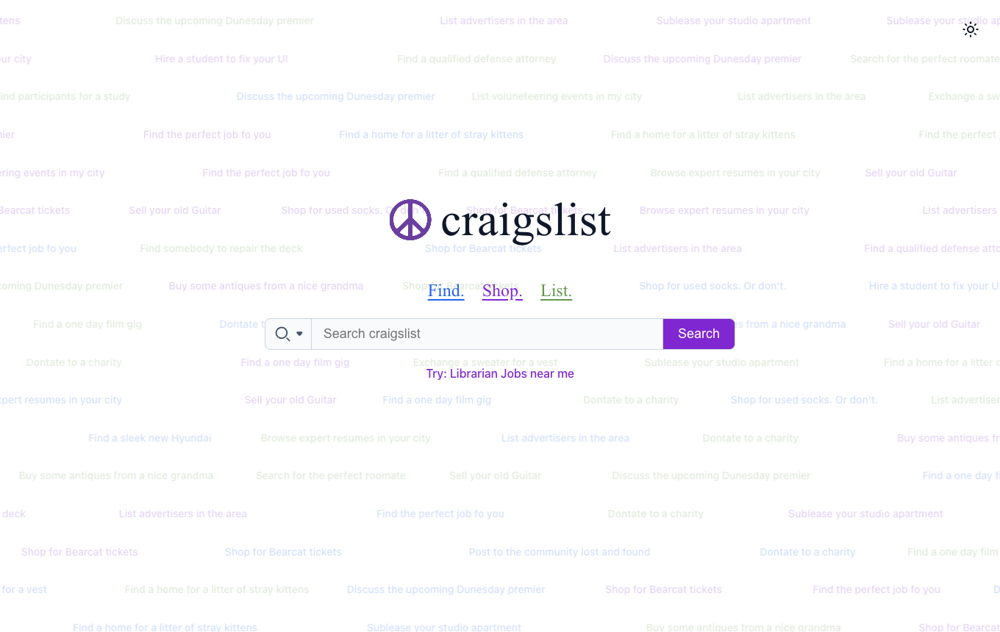
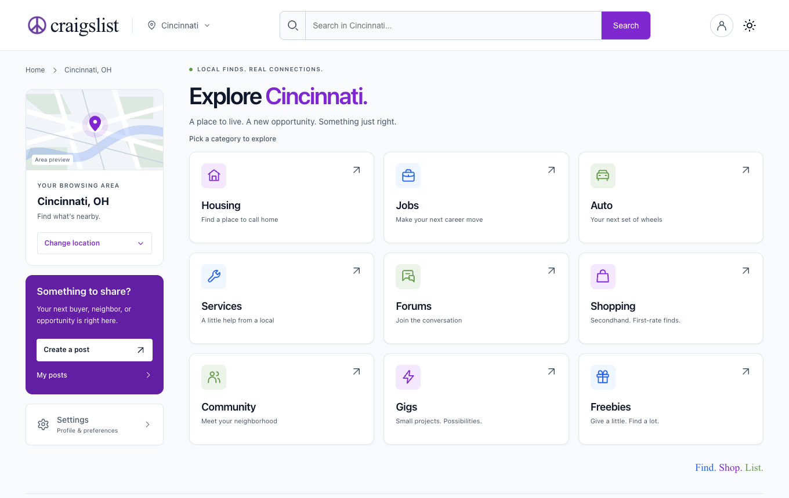
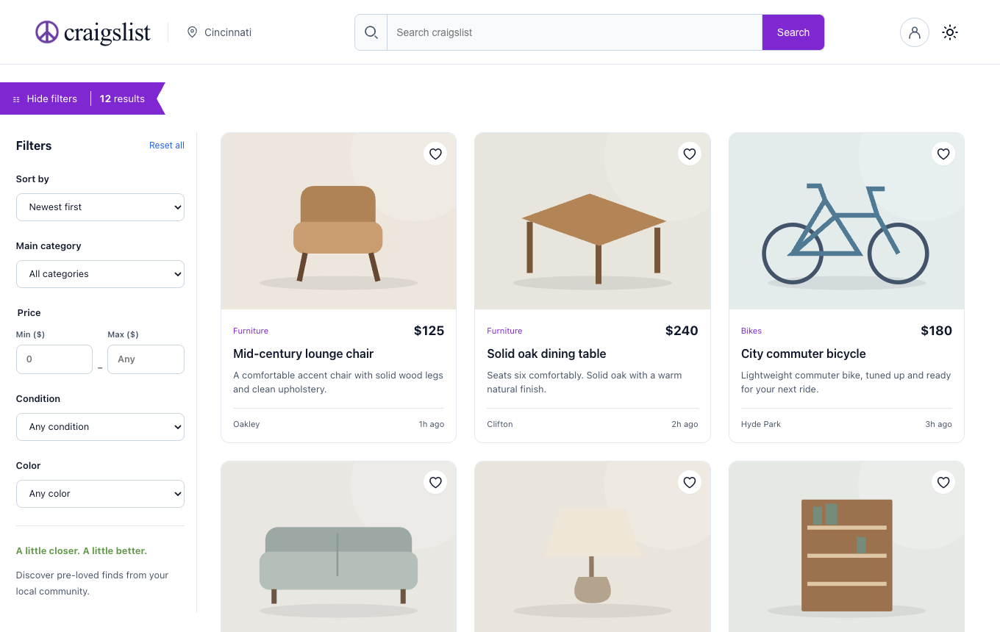

# Project 2: Craigslist Redesign 

| Table of Contents |
| -------- |
| [Project Description](#project-description) |
| [Design](#design) |
| [Describing The Interface](#describing-the-interface) |
| [Implementation](#implementation) |
| [Future Work](#future-work) |
| [AI Use Documentation](#ai-use-documentation) |
| [Demo Video](#demo-video) |
| [Link to Repo and Hosted Application](#link-to-repo-and-hosted-application) |

## Project Description

The focus of this project is to choose an existing user interface with real usability problems, research how people use it, and redesign it. We chose the [Craigslist Cincinnati homepage](https://www.craigslist.org/area/cincinnati).

Our research showed that users had trouble finding categories in Craigslist's crowded wall of links, did not notice the location selector, could not easily tell jobs apart from gigs, and found creating a listing confusing. Based on these findings, our redesign focuses on:

- A simpler homepage with less text and fewer links
- Main categories that expand into subcategories, with icons and short descriptions
- A visible location selector that is available on every screen
- Search filters that are easier to find and use
- A clearer, step-by-step process for creating a post

The redesign is a working prototype made of three connected screens: a home screen, a location screen for browsing one city, and a search screen for comparing listings. It runs entirely in the browser with sample data and does not connect to the real Craigslist.

[⬆️ Back to Table of Contents](#project-2-craigslist-redesign)

## Design

### 1. Choosing UI to Fix

[UI Redesign Selection](https://github.com/Dan-Nassirharand/user-interface-cs-5167/blob/proj-2/project-2/design/ui-selection.md)

### 2. Redesign Research

#### Research Method 1:
[Survey](https://github.com/Dan-Nassirharand/user-interface-cs-5167/blob/proj-2/project-2/design/redesign-research/survey.md)

#### Research Method 2:
[Observational Study](https://github.com/Dan-Nassirharand/user-interface-cs-5167/blob/proj-2/project-2/design/redesign-research/observational-study.md)

#### Research Method 3:
[Heuristic Evaluation](https://github.com/Dan-Nassirharand/user-interface-cs-5167/blob/proj-2/project-2/design/redesign-research/heuristic-evaluation.md)

#### Design Plans Based on Research Methods:
[Focused List of Design Plans](https://github.com/Dan-Nassirharand/user-interface-cs-5167/blob/proj-2/project-2/design/redesign-research/design-plans.md)

### 3. Sketching and Feedback
[Sketching and Feedback](https://github.com/Dan-Nassirharand/user-interface-cs-5167/blob/proj-2/project-2/design/sketching-and-feedback/sketching-and-feedback.md)

[⬆️ Back to Table of Contents](#project-2-craigslist-redesign)

## Describing The Interface

The prototype has three screens. Every screen has a dark mode toggle, and the header on the location and search screens always shows the current city.

### Home Screen



The home screen keeps only what users need to get started: the title, a search bar, and three words that sum up what Craigslist is for. Hovering over or clicking Find, Shop, or List shows a short definition. The search bar has a dropdown to switch between Search mode, which opens the search screen, and Location mode, which opens the location screen for a city. A random suggestion under the search bar can be clicked to copy it. Example posts scroll slowly in the background.

More details: [Home Screen Documentation](./documentation/HomeScreenDocs.md)

### Location Screen



The location screen is where users browse one city. The selected city is shown in a card at the top of the sidebar, and it can be changed from that card or from the header. Instead of a wall of links, nine main categories are shown as tiles with icons and short descriptions. Clicking a tile opens its subcategories, and clicking a subcategory opens the search screen. The sidebar also has a Create a post button, which opens a three-step posting form, as well as links to My posts and Settings.

More details: [Location Screen Documentation](./documentation/LocationScreenDocs.md)

### Search Screen



The search screen puts listing photos, prices, and filters in one place so users can compare items without moving between pages. The filter sidebar can be hidden to give the listings more room. Users can filter by category, subcategory, price, condition, and color, and sort by date or price. Clicking a listing opens a dialog with more details, a map illustration, and a clearly labeled Reply button for contacting the seller.

More details: [Search Screen Documentation](./documentation/SearchScreenDocs.md)

### How the Design Plans Were Addressed

| Design Plan | What We Built |
| -------- | -------- |
| 1. Simplify the layout of the homepage | The home screen only shows a title, a search bar, and three words. Categories were moved to the location screen. |
| 2. Improve navigation of categories | Nine main category tiles with icons and descriptions. Subcategories are only shown after a category is opened. |
| 3. Improve the location selector | The current city is shown in the header and in its own card on the location screen. Users can also search for a city from the home screen. |
| 4. Improve the searching experience | A filter sidebar that can be shown or hidden, with an active filter count. Gigs has its own tile on the location screen, separate from Jobs. |
| 5. Simplify the listing process | A visible Create a post button and a three-step form with clear labels, drafts, and a preview. Listings have a visible Reply button. |

[⬆️ Back to Table of Contents](#project-2-craigslist-redesign)

## Implementation

### Technical Stack

The prototype was built with Svelte 5 and JavaScript, and is bundled and served with Vite. There is no backend. It is a single-page application that runs entirely in the browser.

| Tool / Library | Role |
| -------- | -------- |
| [Svelte 5](https://svelte.dev/) | Component framework, using runes (`$state`, `$derived`, `$effect`, `$props`, `$bindable`) for reactivity |
| [Vite](https://vite.dev/) | Development server and production bundler |
| [`@sveltejs/vite-plugin-svelte`](https://github.com/sveltejs/vite-plugin-svelte) | Compiles `.svelte` files within Vite |

No CSS framework or icon library is used. Each component has its own scoped CSS, and the shared colors, font sizes, corner radii, and shadows are defined as CSS custom properties in `theme.css`. Dark mode works by switching a `data-theme` attribute on the page, which swaps the color values in `theme.css`.

### Code Structure

```
newCraigslist/
├── public/
│   ├── mock/                  # images for the sample listings
│   └── static/                # logo and favicon
└── src/
    ├── main.js                # mounts <App />
    ├── App.svelte             # routing between the three screens and the selected city
    ├── app.css, theme.css     # global styles, colors, and light/dark themes
    ├── listings.js            # sample listings and search categories
    │
    ├── Home.svelte            # home screen
    ├── HomeBackground.svelte  # scrolling example posts
    ├── Title.svelte           # craigslist title and logo
    ├── WordCardWrapper.svelte, WordCard.svelte, DictionaryWordCard.svelte
    ├── Suggestion.svelte      # click-to-copy search suggestion
    │
    ├── LocationPage.svelte    # location screen, categories, and location picker
    ├── PostComposer.svelte    # three-step Create a post form
    ├── MyPosts.svelte         # list of posts saved in the browser
    ├── SettingsPanel.svelte   # profile and preferences
    ├── LocationIcon.svelte    # icons used on the location screen
    │
    ├── SearchResults.svelte   # search screen, filters, and listing details
    │
    ├── Header.svelte          # shared header for the location and search screens
    ├── SearchBar.svelte, SearchModeSelect.svelte
    ├── ThemeToggle.svelte     # dark mode switch
    ├── Footer.svelte, BackToTop.svelte
    └── assets/icons/          # SVG icons
```

### Routing and Data

`App.svelte` handles navigation between the three screens using the browser's History API, so each screen has its own URL and the back and forward buttons work:

| URL | Screen |
| -------- | -------- |
| `/` | Home screen |
| `/location?location=cincinnati-oh` | Location screen for a city |
| `/search-final?location=cincinnati-oh&q=chair` | Search screen, with an optional keyword, category, and subcategory |

All data is local. The sample listings come from `listings.js`, and the ten supported cities are defined in `LocationPage.svelte`. Posts, drafts, profile settings, and the dark mode preference are saved in the browser's `localStorage`.

### Running Locally

Node.js is required. From the `project-2/newCraigslist` folder:

```bash
npm install
npm run dev      # starts the development server at http://localhost:5173
npm run build    # creates a production build in dist/
```

[⬆️ Back to Table of Contents](#project-2-craigslist-redesign)

## Future Work

The current prototype uses sample data and only saves information in the browser. Future work would focus on the following:

- **Connect to real data:** Load real listings for each city instead of a small set of sample items. Right now, every sample listing is in For sale, and changing the city does not change the results.
- **Make the categories consistent:** The location screen and the search screen use different category lists. For example, Gigs is its own category on the location screen but a subcategory of Jobs on the search screen. Using one shared list would also let every subcategory open the search screen with the right filters selected.
- **Add accounts:** Save posts, favorites, and settings to an account so they are available on any device. Posts should also appear in the search results and be editable after they are saved.
- **Search by distance:** Our design plans included searching for listings within a certain distance of a location, which has not been implemented yet.
- **Filters for each listing type:** Show different filters for different categories, such as bedrooms for housing or pay for jobs.
- **Address autocomplete:** Suggest neighborhoods and addresses while creating a post.
- **Usability testing:** Test the finished prototype with users to check whether it solves the problems found in our research.

[⬆️ Back to Table of Contents](#project-2-craigslist-redesign)

## AI Use Documentation

In general, AI was used to help format and organize documentation. The substance of the documentation, including research, sketches, interview feedback, and design decisions, was written without the help of AI. AI was not used to replace the team's judgment.

The below list is included to remain in adherence with the class and university
academic integrity policy.

Generative models were used in the following applications:

- Organize the project files and directories, including renaming files and moving images
- Structure and format the research and design documents
  - AI was used to help format and organize documentation. Substance was written without AI help.
- Clean up formatting, grammar, and typos
  - Interview feedback was cleaned up for typos and formatting without changing its meaning.
- Link sketches and images in the sketching and feedback document

### Implementation and Screen Documentation

AI use during implementation is described by each screen's documentation:

- [Home Screen Documentation](./documentation/HomeScreenDocs.md#ai-disclosure): Claude Code was used to build the home screen components, with the design choices and final edits made manually.
- [Search Screen Documentation](./documentation/SearchScreenDocs.md#ai-disclosure): ChatGPT was used to help write the documentation.
- [Location Screen Documentation](./documentation/LocationScreenDocs.md#ai-disclosure): Claude Code was used to write the documentation from the location screen code.

### Final Documentation

The Project Description, Describing The Interface, Implementation, and Future Work sections of this README were drafted with Claude Code (model: `claude-opus-5-5`) based on the project code and design documents. The screenshots were taken from the running prototype, and the descriptions were checked by using the prototype in a browser.

[⬆️ Back to Table of Contents](#project-2-craigslist-redesign)

## Demo Video

<!-- TODO: add the demo video link -->

[⬆️ Back to Table of Contents](#project-2-craigslist-redesign)

## Link to Repo and Hosted Application
[GitHub Repo](https://github.com/Dan-Nassirharand/user-interface-cs-5167/tree/proj-2/project-2)  
<!-- TODO: this link currently opens a Project 1 app, not this Craigslist redesign. Replace it with the Project 2 deployment. -->
[Hosted App](https://vasilev-project-1.vercel.app/)  

[⬆️ Back to Table of Contents](#project-2-craigslist-redesign)
