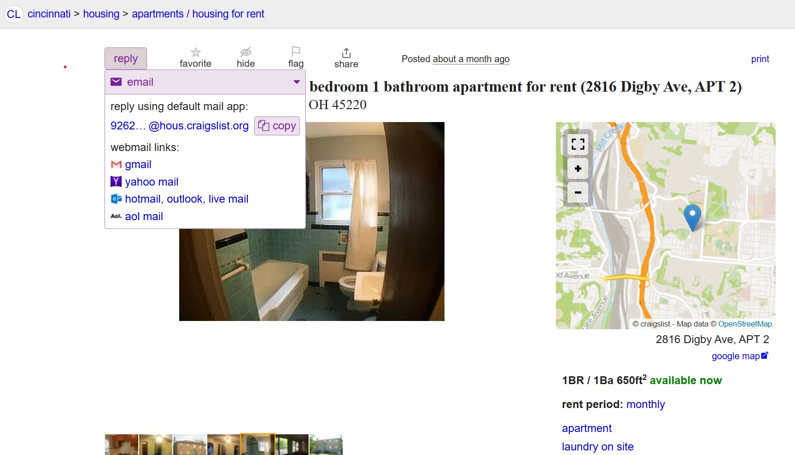
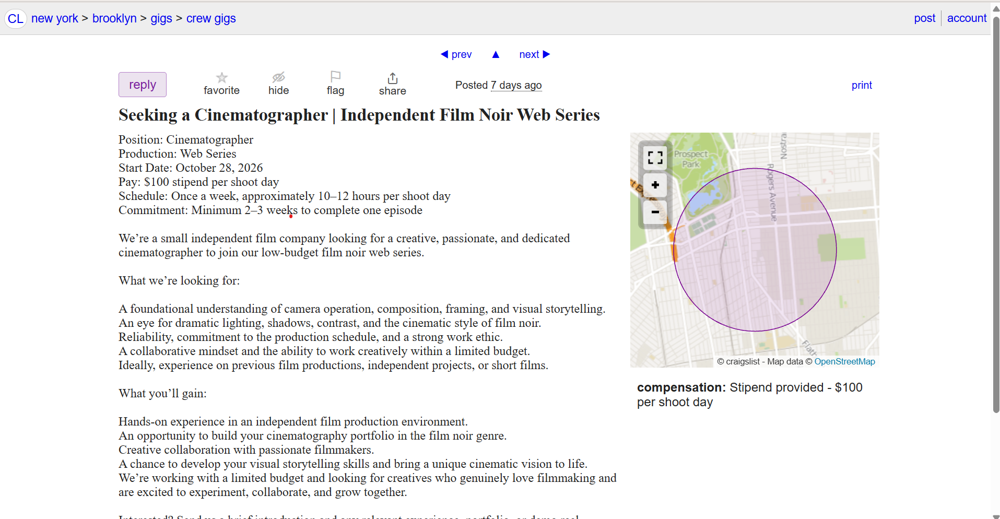
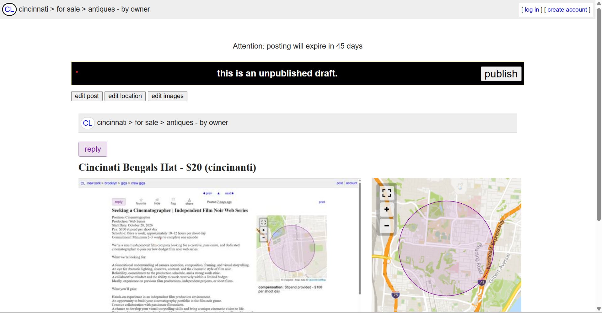

# Using an Observational Study with Think Aloud Protocol
To try to get a better understanding of 'whats wrong' with Craigslist, we are going to devise an observational study. This study will have 3 participants and each of them will be given tasks to complete and communicate in detail their thought-process. 

## Rules
- The proctor may not communicate with the participant when they are doing a task.
- The only material the participant is given is a clear objective goal sheet with these rules in the footnotes.
- The participant will be recoreded wile they are completing the tasks.
- Each task will start at this home page https://www.craigslist.org/about/sites#US.
- Each participant will start at the same place and perform the actions individually
- Before any tasks, the proctor must explain the `think-aloud` component using this quote:
```
As you participate today, I would like you to do what we call “think out loud.” What that means is that I want you to say out loud what you are thinking as you work. Let me show you what I mean. I am going to think out loud as I try to send a text message on this mobile phone. OK, I am looking at the home screen of the phone. I would expect there to be an icon that says “text” or “messages” right here on the home screen, but I don’t see that here. I’m confused by that. I’m going to look in other places for it. I think I’ll try to click on this icon of a callout bubble because that seems like it might be related to talking, like “I talk, the other person talks.” Okay, now that that is open, I see an icon that says “text messages.” I’m glad to see that there because that is what I was expecting to see.
```


## Tasks

### Task 1: Email apply for a Studio Apartment walkable to the University of Cincinnati for under 1000$


### Task 2: Find a 1 day paid film related gig in New York City


### Task 3: Create (but no not publish) an Online listing for any item


### Post Task Completion Interview

## Results

### Participant 1
##### Task 1
At first, Bo was unsure of what Craigslist is. Once he got to the website, he had no idea what the site was for. He was told he could find apartments on there
So, he found Cincinnati after looking at the map. Once he found Cincinnati, he knew he had to set a price. 
After setting the price well, he tried a few places but saw that none of thme were around UC, he put University of Cincinnati in the search bar. 
He said that it was not intuitive and he had to click a ton of buttons. 

##### Task 2
The participant said part of the challenge was the language barrier. This participant is from Taiwan so he is ESL. He started by using words that he knew, but when he couldn't find a one day thing he kept trying until he did find one job that pays per day. This was accepted in the challenge. The hardest part was following the language.

##### Task 3
Participant said the confusing thing was how to post it as food (Not on website / addable). When he posted, he saw the QR code which he said was convienent. Since it was the third time on the site, he was able to use the post icon and led him with options to the desired page. When he typed in the address, he wishes it would autofill. 

### Participant 2
##### Task 1
Really shocked at home page. Looked around the whole site. Went to US, found Ohio -> Cincinnati. Immediatly saw housing and went under apartments. First he filtered the price. Participant first wondered how to find uc, and eventually found the map feature. The participant needed to find UC on the map which required him to find UC on a map. Once he found that he zoomed in and clicked the first under 900$ one. Subject printed the apartment. Struggled to find the email option, thought the website didnt have it and was missing the info. Then he looked for an apply button and did not find one. But he found reply and was able to complete the task. 

Thoughts: "The worst website on earth". Ugly, scammy website. Also the pictures look terrible. This made him say he would first look for a different website. Also the reply button is so confusing. Final website comment is that it was low budget and old. Also all locations on earth were so strange to be listed out like that. 

##### Task 2
Subject almos tried to find NYC on the map, but thought finding NYC would be better. Then the Job section caught his mind and he saw film so he clicked on it. He looked over the listings for jobs but only found part or full time jobs (no gig concept). He tried searching with the filters for contracted jobs and applied the filter. No one day so he thinks contract would be good. The subject said this wasn't good enough and tried going back to the city home page. Once he was there he looked through the creative ones and saw something that matched the description quickly. 

Thoughts: "Gigs were much harder to find than apartments. It felt really akward to find Gig vs Job". The one day thing tripped them up and the sorting was really difficult. Gigs were far down and he wasn't prompted to scroll because Jobs worked. The website was not any better to use the second time

##### Task 3
Subject thought posting a listing may be at the bottom, but went back to his city after not finding it. He saw the post option very fast once he got to city (not confusing). He then went thought the post 'quiz' or 'qizard'. He (along with other participant) found it really hard to get a category for the pen. He was able to make the post really fast. Again, he filled out every single category like model and make. The participant. He tried to use the map to set the street and address which did not work for him. 'Cross st' confused him. 
Thoughts: This one felt a little more simple. He thought it should be on the home page instead of the location page. After that the quiz helped him and it was easy. Still ugly. 

### Participant 3

### General 

# Findings 

# Addressables