# Sketching and Feedback

Sketches of three Craigslist pages were created, 3-4 alternatives per page. The sketches were then shown to three users who were asked to share their thoughts on each one. The feedback was used to inform one final sketch per page.

## Initial Sketches

### Home

Redesign of [https://www.craigslist.org/about/sites](https://www.craigslist.org/about/sites)

**Sketch 1**

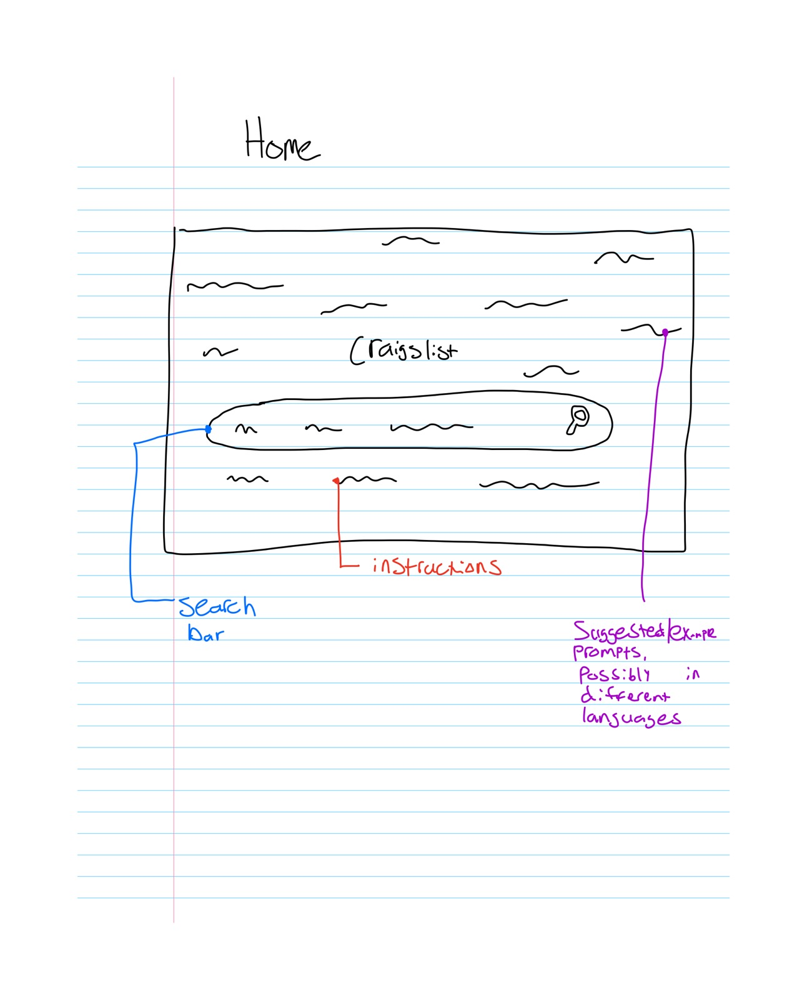

**Sketch 2**

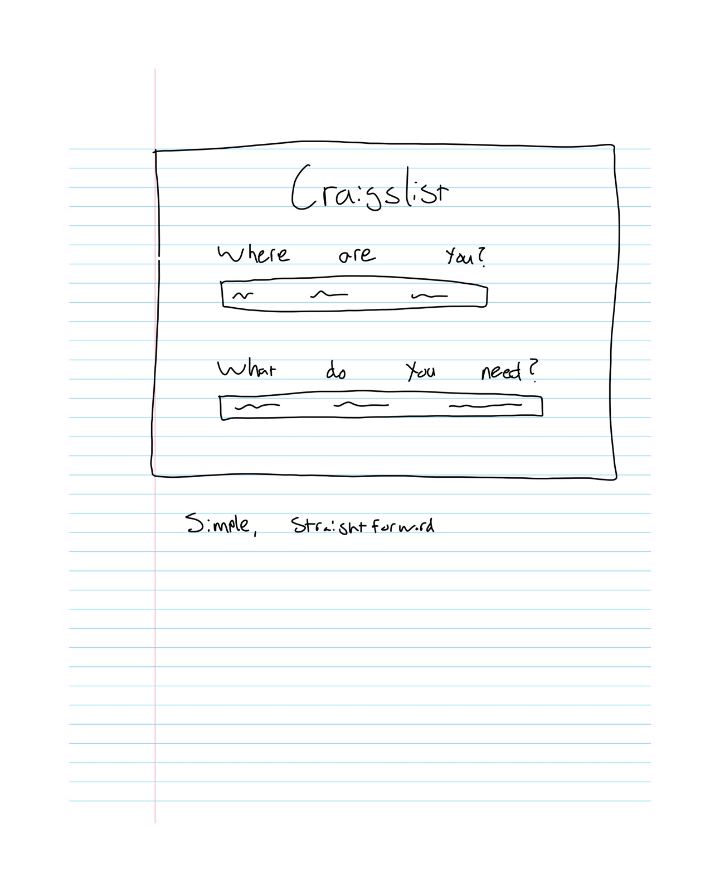

**Sketch 3**

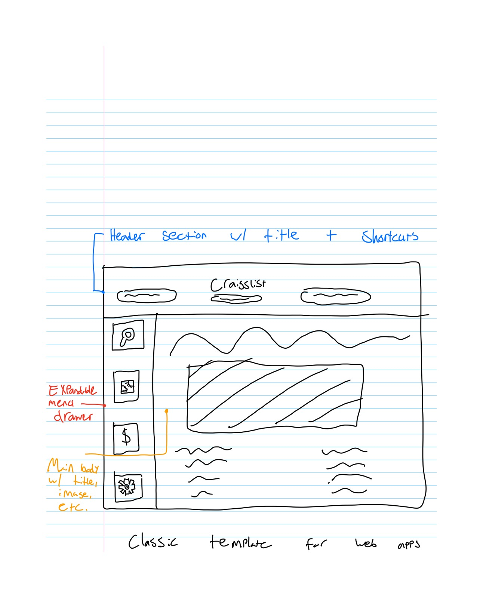

**Sketch 4**

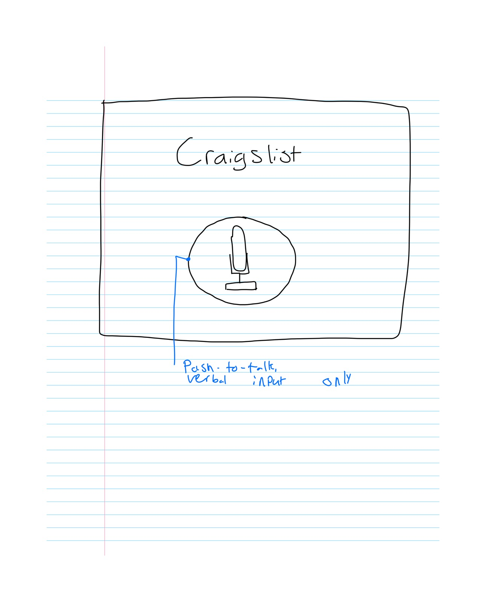

### Location / Area

Redesign of [https://www.craigslist.org/area/cincinnati](https://www.craigslist.org/area/cincinnati)

**Sketch 1**

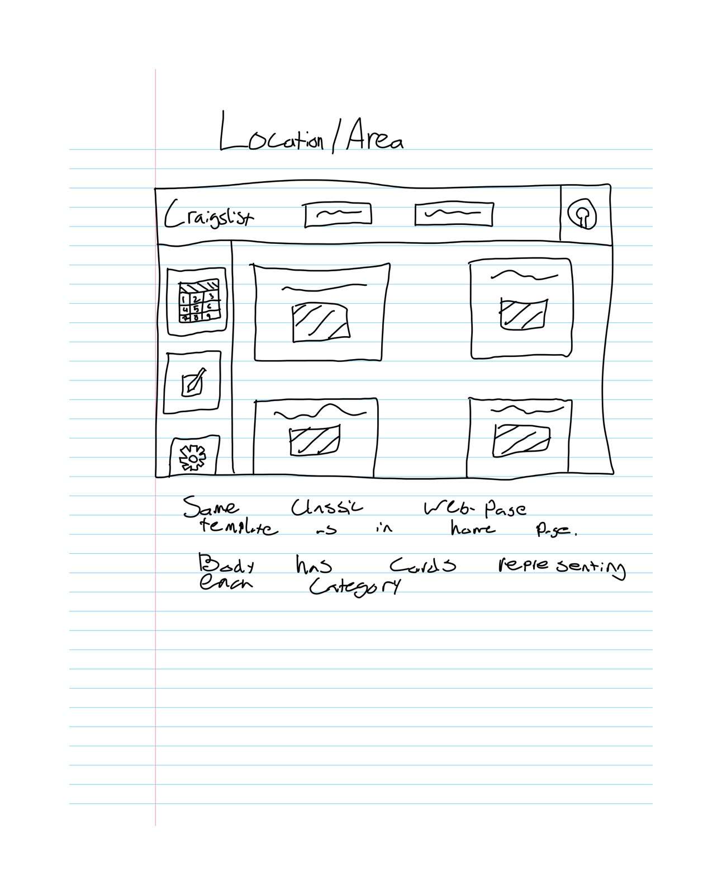

**Sketch 2**

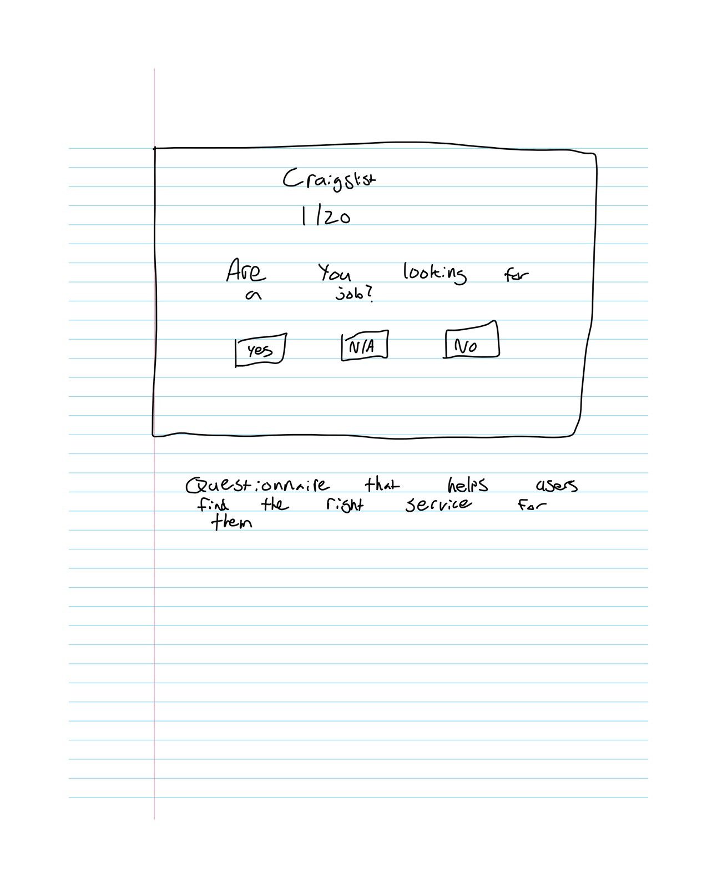

**Sketch 3**

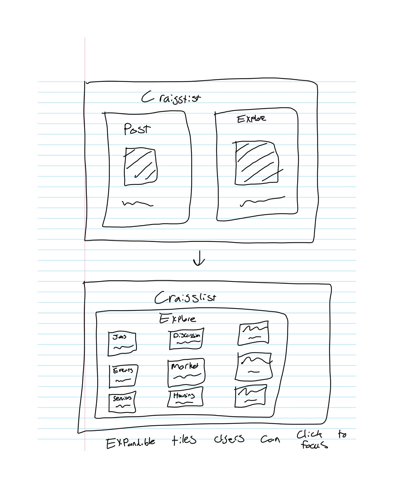

### Search

Redesign of [https://www.craigslist.org/search/area/cincinnati?cat=ata#search=2~gallery~3](https://www.craigslist.org/search/area/cincinnati?cat=ata#search=2~gallery~3)

**Sketch 1**

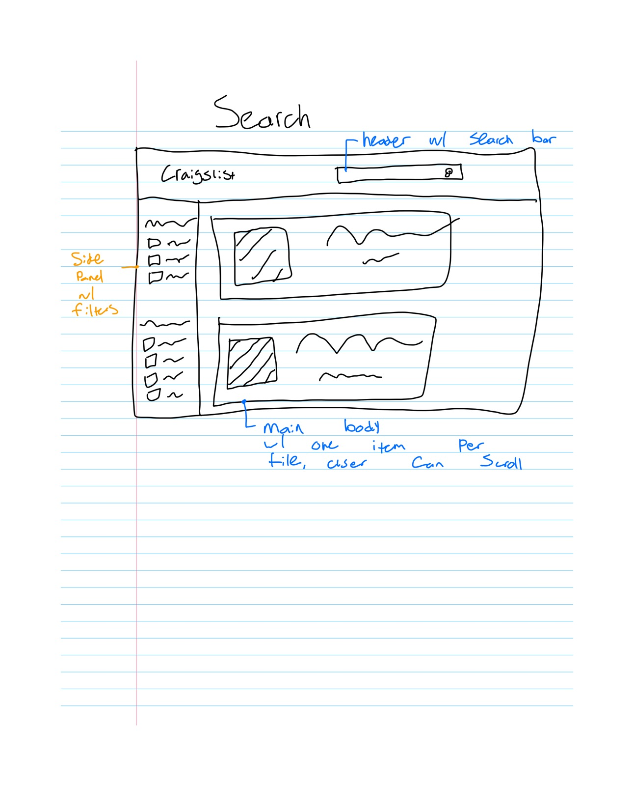

**Sketch 2**

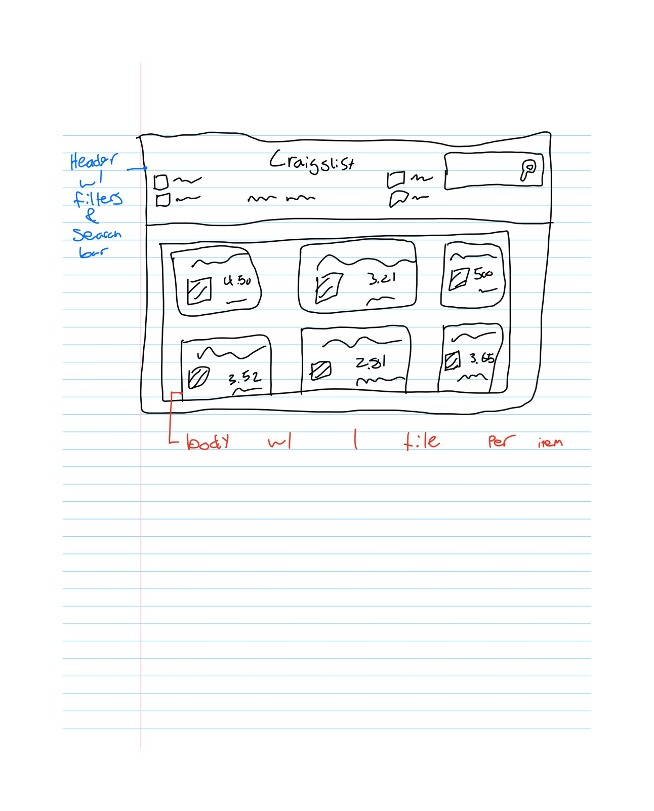

**Sketch 3**

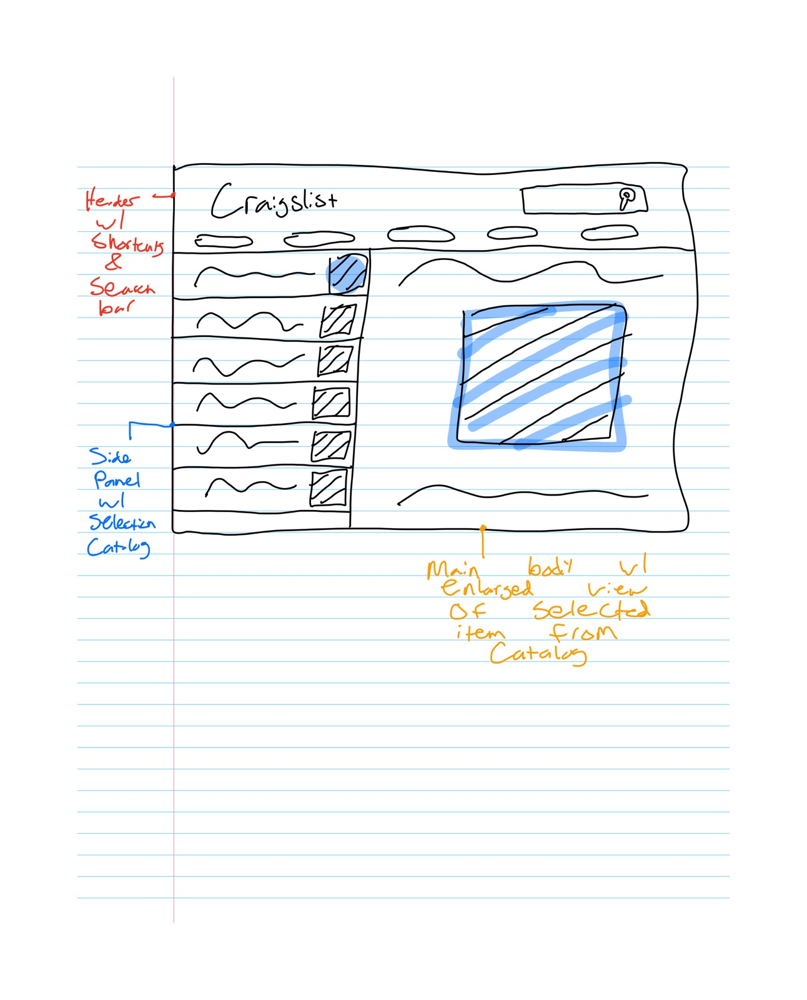

## Interview 1: P1 (Classmate)

### Home

- **Sketch 1:** Show the instructions inside the search bar itself. Suggestions and examples in the background are distracting and take the focus away from Craigslist's core purpose.
- **Sketch 2:** Simple. The site should get the user's location from the browser by default, while still allowing them to explore other locations.
- **Sketch 3:** Looks good, no comments.
- **Sketch 4:** If natural language search is needed, it would be better as a component of a different UI.

### Location / Area

- **Sketch 1:** Looks good, no notes.
- **Sketch 2:** The wording needs to be straightforward to interpret.
- **Sketch 3:** Would work better as the first page instead of the location / area page.

### Search

- **Sketch 1:** Put basic filters (e.g., sort by) at the top for higher visibility.
- **Sketch 2:** Good, but prefers Sketch 1. Does not like that the header has filters.
- **Sketch 3:** Favorite. It would be nice if recommended items also appeared on the right side of the screen, similar to the currently focused item.

## Interview 2: P2 (Classmate)

### Home

- **Sketch 1:** Nice and simple; makes the user want to click the search bar and type something in.
- **Sketch 2:** Doesn't like it as much. Doesn't like being asked about location even though it is needed. Feels abrupt. The wording of "what do you need" could be changed.
- **Sketch 3:** Busier than the first one, but allows for options. Could be overwhelming for new users. The header draws attention, then the user naturally goes down to the body. OK, but make sure the body presents information clearly.
- **Sketch 4:** Simple, but not enough instruction. The user wouldn't even know the button is for verbal input. The home page does not give enough information about what the site is.

### Location / Area

- **Sketch 1:** Good, as long as care is taken with the size of the cards. Maybe 3 per row makes more sense.
- **Sketch 2:** Need to think about the order of the questions and ways to recover from errors. This could be a popup/feature rather than an entire page.
- **Sketch 3:** Back button is important. Each category tile would need some sort of description.

### Search

- **Sketch 1:** Emphatically likes this. Include more tiles than what is shown. Make images primary focus.
- **Sketch 2:** Also likes this, enjoys being able to see more tiles compared to Sketch 1. If the header can be collapsible or automatically collapse when scrolling, it would maximize space for tiles.
- **Sketch 3:** Thinks this is cool, would like to see filters included. Likes that many items can be viewed at the same time, and really enjoys this feature on shopping websites.

## Interview 3: P3 (Coworker)

### Home

- **Sketch 1:** Compared UI to Mentimeter, likes the idea of suggested prompts. Likes overall.
- **Sketch 2:** Likes it, but would like more guidance. Perhaps a dropdown or suggestions.
- **Sketch 3:** Likes it, but prefers a more simple, straightforward approach.
- **Sketch 4:** Given the backend works effectively, would enjoy. Would need instructions similar to Sketch 1.

### Location / Area

- **Sketch 1:** Simple, a template users have seen before on other webpages, but for good reason. Has everything one needs.
- **Sketch 2:** Likes that user doesn't have to think too hard, takes away complexity from users, especially in relation to understanding filter options.
- **Sketch 3:** Likes it, simple, easy to browse, and efficiently guides the user to the area they want to be in.

### Search

- **Sketch 1:** Similar to existing technologies, likes the ease of use. Side panel with filters is quite familiar.
- **Sketch 2:** Similar feedback to Sketch 1. Indifferent between the two. Still prefers filters on the side.
- **Sketch 3:** Compared to Outlook/email. Also a familiar format.

## Final Sketches

### Summary

Across all three pages, users responded best to simple, familiar layouts. The final sketches build on the initial sketches that users liked most, with changes drawn from their remaining concerns.

- **Home:** Sketch 1 was selected for its simple, familiar UI and low learning curve. Instructions will move into the search bar and the user's location will come from the browser.
- **Location / Area:** Sketch 1 was selected unanimously for its familiar layout, which aligns with industry standards for category navigation. Card size will be tuned.
- **Search:** Sketch 2 was selected for its positive feedback and internal consistency with the other pages. Filters will move to a collapsible side panel to maximize room for viewing options.

### Sketches

#### Home

Based on [Sketch 1](images/home-1.jpg).

<!-- TODO: add final sketch once drawn -->

#### Location / Area

Based on [Sketch 1](images/location-1.jpg).

<!-- TODO: add final sketch once drawn -->

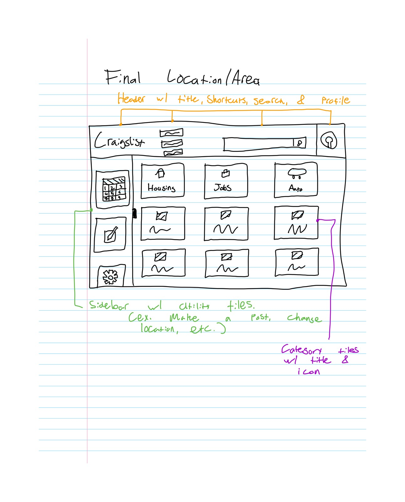

#### Search

Based on [Sketch 2](images/search-2.jpg).

<!-- TODO: add final sketch once drawn -->

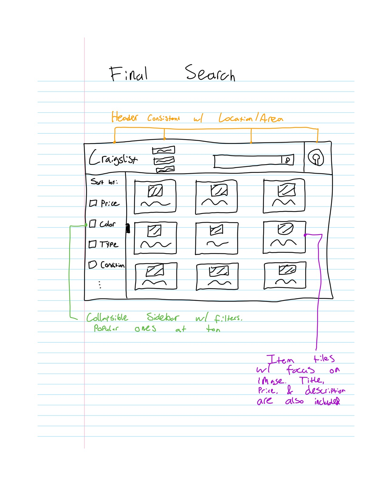

### Rationale

#### Home

Users liked the simple and familiar UI. They felt invited to interact with the application, indicating a low learning curve that supports usability, efficiency, and user retention.

Selecting this sketch as the template for the final design directly addresses design plans [1 (simplify the layout of the homepage)](../redesign-research/design-plans.md#1-simplify-layout-of-the-homepage) and [4 (improve the searching experience)](../redesign-research/design-plans.md#4-improve-the-searching-experience). Assuming a powerful backend, it would also support plans [2 (improve navigation of categories)](../redesign-research/design-plans.md#2-improve-navigation-of-categories) and [3 (improve the location selector)](../redesign-research/design-plans.md#3-improve-location-selector), since the user does not have to manually parse locations or categories.

Changes from feedback:

- Show instructions inside the search bar itself rather than as background suggestions, which are distracting (P1).
- Get the user's location from the browser by default, while still allowing them to explore other locations (P1).
- Make sure the page communicates what the site is, as the lack of this was a concern with Sketch 4 (P2).

#### Location / Area

Users unanimously liked the familiar, simple layout of Sketch 1. This is expected, as the layout has a high level of external consistency, aligning with existing industry standards for category navigation.

This sketch most directly addresses design plans [2 (improve navigation of categories)](../redesign-research/design-plans.md#2-improve-navigation-of-categories) and [4 (improve the searching experience)](../redesign-research/design-plans.md#4-improve-the-searching-experience), with room to address plan [5 (simplify the listing process)](../redesign-research/design-plans.md#5-simplify-the-listing-process) given suitable design choices in the final sketch and implementation.

Changes from feedback:

- Take care with the size of the cards; 3 per row may make more sense (P2).

#### Search

Sketch 2 was selected based on overall positive feedback from users, as well as the benefit of internal consistency with the other changes. It addresses design plans [2 (improve navigation of categories)](../redesign-research/design-plans.md#2-improve-navigation-of-categories) and [4 (improve the searching experience)](../redesign-research/design-plans.md#4-improve-the-searching-experience).

The main concern users raised, the filters in the header, will be addressed in the final sketch and implementation by moving the filters to the side of the screen and making them collapsible, maximizing the room users have to view options.

Changes from feedback:

- Move the filters from the header to a side panel (P1, P3).
- Make the filters collapsible to maximize space for tiles (P2).
