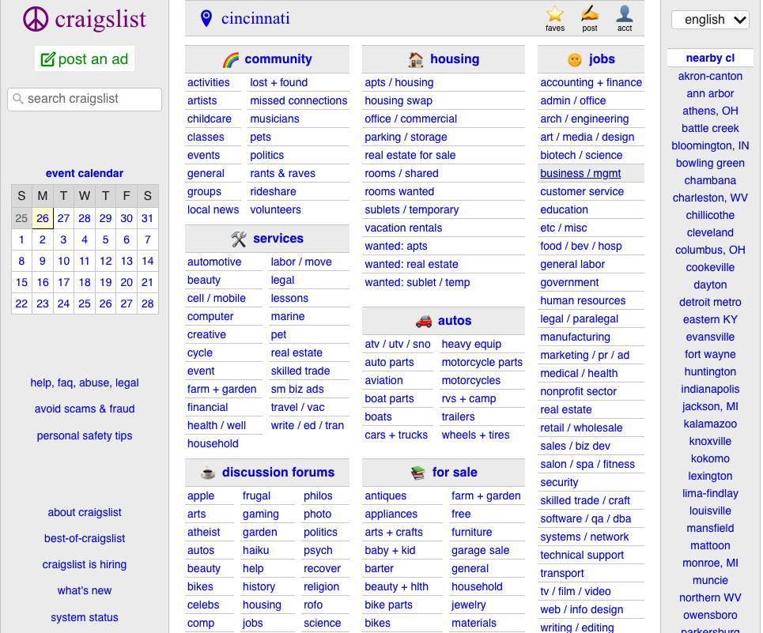
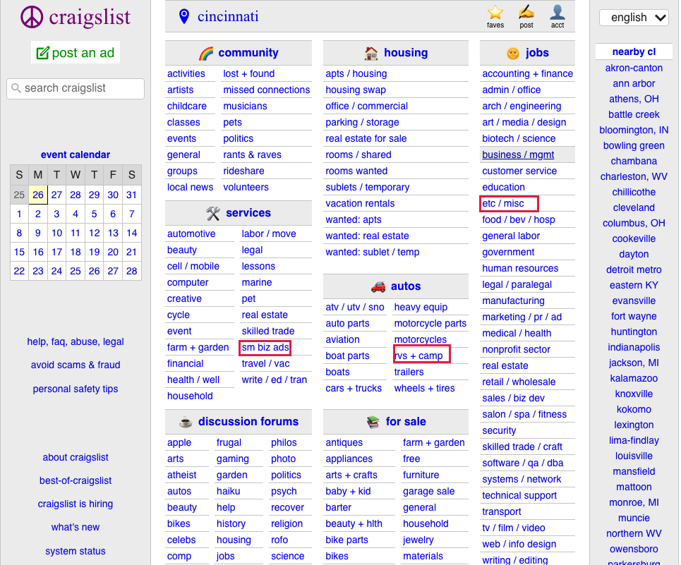
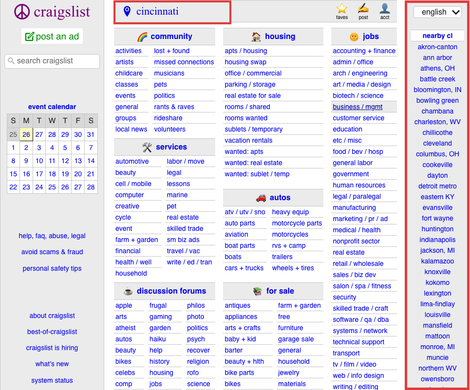

## Task 3: Heuristic Evaluation — Craigslist Homepage

### Method

I used Nielsen's 10 Usability Heuristics to review the Craigslist Cincinnati homepage. I focused on the layout, categories, and navigation.

I rated each problem from 0 (no problem) to 4 (very serious).

### Findings

#### 1. Crowded Layout (Severity: 3/4)
- **Heuristic:** Aesthetic and Minimalist Design
- **Issue:** The homepage shows too many links under Housing, For Sale, Jobs, and other sections. Most links look similar, making the page feel crowded.
- **Impact:** Users may spend more time looking through the links to find what they need.
- **Suggestion:** Show the main categories first, let users expand them, and add more spacing between sections.

#### 2. Unclear Category Names (Severity: 2/4)
- **Heuristic:** Match Between System and Real World
- **Issue:** Some category names, like "sm biz ads," "etc / misc," and "rvs+camp," are not easy to understand.
- **Impact:** New users may not know what these categories mean.
- **Suggestion:** Use clearer names or add short descriptions.

#### 3. Poor Location Selector Placement (Severity: 2/4)
- **Heuristic:** Flexibility and Efficiency of Use
- **Issue:** The option to change locations is on the far right side of the homepage, so it is easy to overlook.
- **Impact:** Users may start browsing without noticing they can change the city.
- **Suggestion:** Move the location selector to the top of the page and clearly show the current city.

### Summary

The main problems with Craigslist's homepage are its crowded layout, unclear category names, and the location selector being hard to notice.

The redesign should make the homepage simpler, with clearer categories and easier navigation.

### Reference

Nielsen Norman Group — 10 Usability Heuristics for User Interface Design

https://www.nngroup.com/articles/ten-usability-heuristics/
